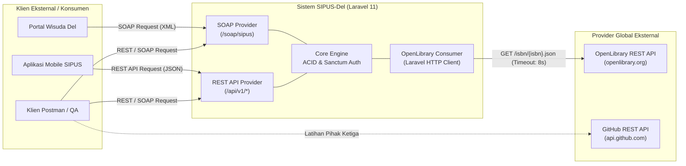
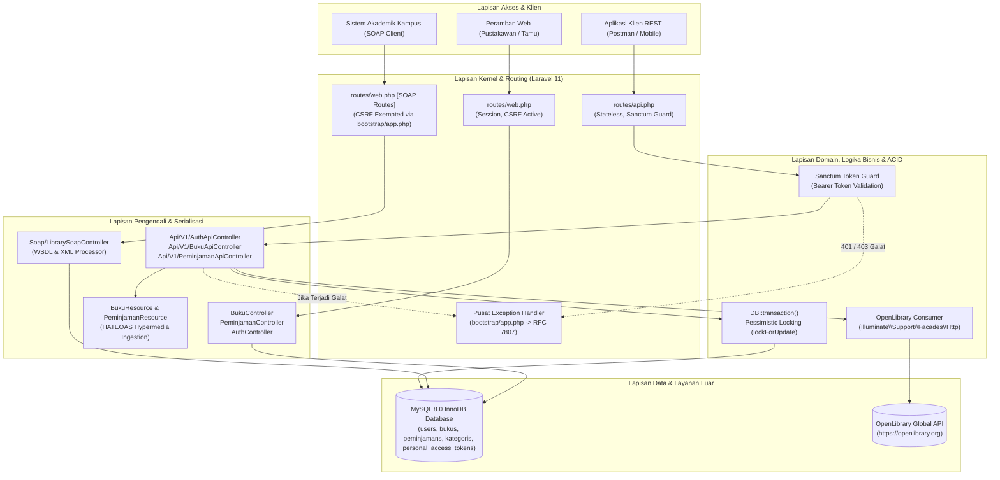
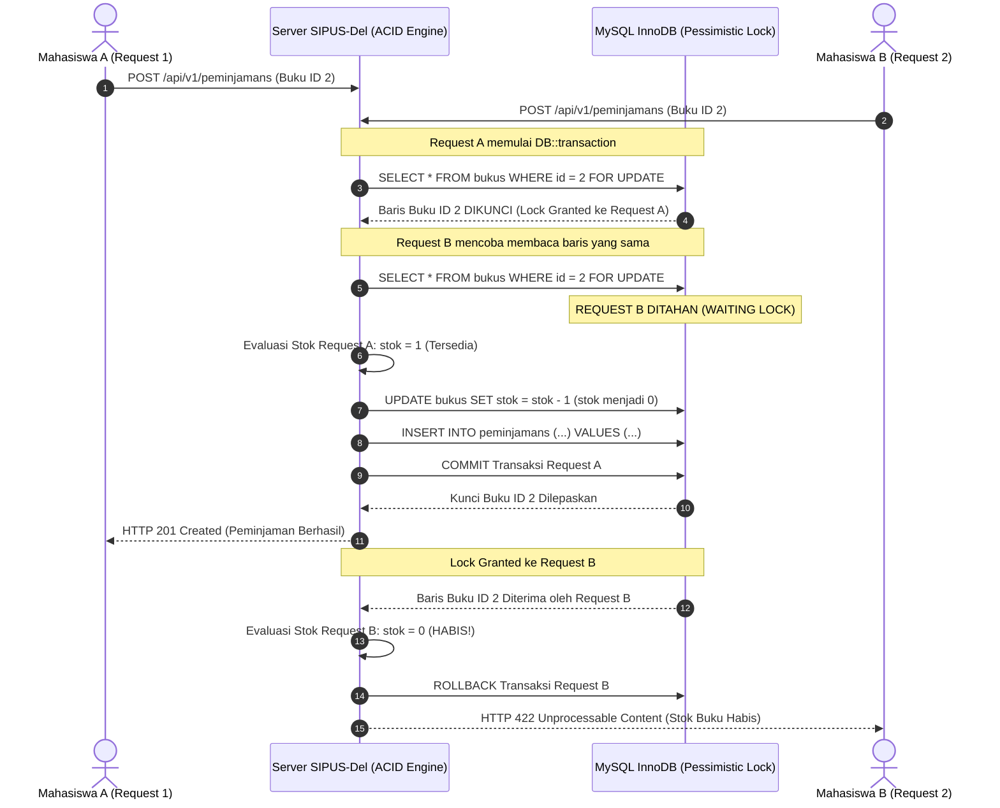
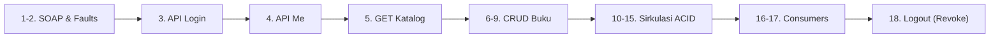
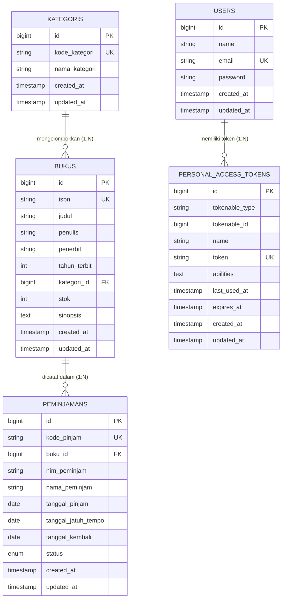

# SIPUS-Del (Tahap 3) — Sistem Informasi Perpustakaan Kampus Del
> Implementasi Arsitektur Web Services Komprehensif: RESTful Web API v1, SOAP Clearance Provider (WSDL), Autentikasi Stateless Laravel Sanctum Bearer Token, Transaksi Konkurensi ACID (`lockForUpdate`), HATEOAS, RFC 7807 Problem Details, Spesifikasi OpenAPI 3.0, serta Konsumsi Layanan Eksternal OpenLibrary pada Laravel 11.x.

Proyek ini dibangun untuk memenuhi penugasan mandiri **Praktikum Minggu 09** Mata Kuliah **Pemrograman & Pengujian Web (1253101)** di Institut Teknologi Del.

---

## 1. Identitas Proyek dan Mahasiswa

- **Nama Lengkap**: Choqy Pananda Sirait
- **NIM**: 12S24012
- **Program Studi**: Sarjana Sistem Informasi
- **Kelas**: 13SI1
- **Dosen Pengampu**: Chandro Pardede, S.Kom., M.Sc.
- **Tahun Akademik**: Semester Ganjil 2026/2027
- **Institusi**: Institut Teknologi Del
- **Cabang Git Aktif**: `week9-rest-api` *(basis pengembangan dari cabang `week6-db-session`)*
- **Alamat Repositori**: [https://github.com/ChoqySirait/ppw-2026-week5-12S24012.git](https://github.com/ChoqySirait/ppw-2026-week5-12S24012.git)

### Kredensial Akun Pengujian Sistem
Sistem telah dilengkapi data awal (*Database Seeder*) untuk keperluan audit autentikasi web Blade maupun token API:
- **Peran Pengguna**: Pustakawan (Administrator Sirkulasi)
- **Alamat Surel**: `pustakawan@del.ac.id`
- **Kata Sandi**: `password123`

---

## 2. Latar Belakang dan Tujuan Pengembangan SIPUS-Del Tahap 3

Pada Tahap 1 dan Tahap 2 (Praktikum Minggu 5 & 6), SIPUS-Del beroperasi sebagai sistem aplikasi monolitik berbasis antarmuka grafis peramban (Server-Side Rendering menggunakan Blade Templating). Meskipun seluruh transaksi sirkulasi peminjaman telah berjalan aman dengan prinsip ACID dan manajemen sesi server, sistem monolitik tersebut memiliki keterbatasan interoperabilitas: data hanya dapat diakses melalui antarmuka web, tidak dapat dihubungkan langsung dengan aplikasi mobile, serta tidak memiliki jalur komunikasi antar-mesin (*machine-to-machine*) dengan sistem akademik kampus lainnya.

**Tujuan Pengembangan Tahap 3 (Minggu 09):**
1. **Transformasi Interoperabilitas Sistem**: Membuka antarmuka terprogram (*Application Programming Interface*) berstandar industri tanpa merusak fungsi web Blade yang telah beroperasi.
2. **Penyediaan Layanan SOAP Provider**: Membangun layanan *Bebas Pustaka (Library Clearance)* berbasis kontrak formal WSDL (`/soap/sipus.wsdl` dan `/soap/sipus`) untuk diintegrasikan secara terstandar dengan Sistem Informasi Kelulusan/Wisuda IT Del.
3. **Penyediaan RESTful Web API v1**: Membangun antarmuka REST API modern berbasis JSON dengan arsitektur stateless, pagination, sorting dinamis, filtering multi-kriteria, kontrol concurrency, dan relasi hipermedia dinamis (HATEOAS).
4. **Keamanan Berbasis Token Tanpa Sesi (Stateless Sanctum)**: Menerapkan mekanisme autentikasi Bearer Token untuk seluruh operasi mutasi katalog dan sirkulasi peminjaman.
5. **Standarisasi Penanganan Kesalahan (RFC 7807 Problem Details)**: Menyediakan format respons galat yang seragam dengan header `application/problem+json` sehingga memudahkan pengembang aplikasi klien melakukan diagnosis.
6. **Integrasi Layanan Eksternal (Service Consumer)**: Menghubungkan SIPUS-Del ke *OpenLibrary Books API* menggunakan Laravel HTTP Client untuk pengayaan metadata buku secara terprogram dan tangguh (*fault-tolerant*).
7. **Kontrak Standar OpenAPI 3.0**: Menyusun dokumentasi spesifikasi API formal dalam format YAML untuk standarisasi siklus hidup rekayasa perangkat lunak.

---

## 3. Analisis Kebutuhan dan Feasibility Web Services

### 3.1 Analisis Kebutuhan Fungsional & Non-Fungsional

| Kategori | Identifikasi Kebutuhan | Spesifikasi Arsitektur / Solusi Teknis |
| :--- | :--- | :--- |
| **Kebutuhan Fungsional** | Verifikasi Bebas Pustaka Mahasiswa | SOAP Web Service dengan operasi `CheckClearanceStatus` menerima parameter `nim_peminjam` dan mengembalikan jumlah pinjaman aktif beserta status bebas pustaka (`is_cleared`). |
| | Manajemen Katalog Buku Terbuka | REST API mencakup operasi `GET` (daftar berhalaman & rincian), `POST` (pendaftaran judul baru), `PUT` (penggantian representasi utuh), `PATCH` (pembaruan parsial), dan `DELETE` (penghapusan terkontrol). |
| | Sirkulasi Peminjaman Atomik | REST API transaksi peminjaman dan pengembalian buku dengan validasi ketersediaan stok, pencegahan duplikasi, dan pencatatan riwayat sirkulasi. |
| | Pengayaan Metadata Koleksi | Service Consumer berbasis REST client yang menghubungi katalog global OpenLibrary berdasarkan nomor ISBN buku lokal. |
| **Kebutuhan Non-Fungsional** | Keamanan Akses Stateless | Autentikasi Bearer Token menggunakan Laravel Sanctum yang dienkripsi/dihash pada database, terisolasi dari sesi cookie web browser. |
| | Integritas Konkurensi Data | Proteksi transaksi ACID menggunakan *Pessimistic Row Locking* (`SELECT ... FOR UPDATE`) pada mesin MySQL InnoDB guna menangkal *race condition*. |
| | Ketahanan Jaringan Eksternal | Pembatasan tenggat waktu koneksi (*HTTP timeout*) 8 detik pada komunikasi eksternal dan mekanisme fallback informatif saat data upstream tidak tersedia. |
| | Kontrak API Terbuka & Jelas | Dokumentasi formal WSDL (XML) untuk SOAP dan OpenAPI 3.0 (YAML) untuk REST API. |

### 3.2 Analisis Kelayakan (*Feasibility Analysis*)
1. **Kelayakan Teknis (*Technical Feasibility*)**: Laravel 11 menyediakan fondasi kuat melalui ekosistem `laravel/sanctum`, komponen `Illuminate\Support\Facades\Http` (berbasis Guzzle), penanganan pengecualian terpusat pada `bootstrap/app.php`, serta dukungan transaksi database `DB::transaction`. Pemrosesan XML SOAP diimplementasikan secara murni (*vanilla PHP DOM/SimpleXML*) dengan pembatasan entitas eksternal (`LIBXML_NONET`) untuk mencegah kerentanan XXE (*XML External Entity*).
2. **Kelayakan Operasional (*Operational Feasibility*)**: Implementasi API dibuat berdampingan (*co-exist*) dengan antarmuka Web Blade yang telah ada. Seluruh rute API dialokasikan pada prefix `/api/v1/` dan SOAP pada `/soap/`, sehingga operasional pustakawan melalui browser tidak mengalami interupsi.
3. **Kelayakan Terhadap Standar Industri (*Standard Feasibility*)**: Penggunaan standar HTTP Status Codes semantik, HATEOAS (*RFC 5988*), RFC 7807 Problem Details, WSDL 1.1, dan OpenAPI 3.0 menjamin kemudahan integrasi dengan pustaka klien di berbagai platform (Java, Python, Mobile Flutter/React Native, Postman, dsb.).

---

## 4. Perbandingan Service Provider dan Service Consumer

Dalam arsitektur *Service-Oriented Architecture* (SOA) dan Web Services modern, entitas sistem dibedakan menjadi penyedia layanan (*Service Provider*) dan pengguna/pembaca layanan (*Service Consumer*). SIPUS-Del Tahap 3 menjalankan kedua peran tersebut secara terintegrasi:



### Tabel Komparasi Peran SIPUS-Del

| Dimensi Evaluasi | SIPUS-Del sebagai Service Provider | SIPUS-Del sebagai Service Consumer |
| :--- | :--- | :--- |
| **Definisi Peran** | Menyediakan endpoint dan kontrak terprogram yang menerima permintaan dari klien luar, memproses aturan bisnis perpustakaan, dan memberikan respons terstruktur. | Menjalankan panggilan terprogram keluar (*outbound request*) untuk mengambil data atau memanfaatkan fungsionalitas dari sistem pihak ketiga. |
| **Endpoint Terlibat** | - `GET /soap/sipus.wsdl`<br/>- `POST /soap/sipus`<br/>- `POST /api/v1/auth/login`, `POST /api/v1/auth/logout`<br/>- `GET/POST/PUT/PATCH/DELETE /api/v1/bukus`<br/>- `GET/POST/PATCH /api/v1/peminjamans` | - `GET /api/v1/bukus/{id}/referensi-eksternal` *(secara internal memanggil endpoint `https://openlibrary.org/isbn/{isbn}.json`)* |
| **Protokol / Gaya Arsitektur** | - SOAP 1.1 melalui HTTP POST dengan dokumen kontrak WSDL.<br/>- RESTful Web API v1 melalui HTTP semantik (JSON). | REST Client berbasis protokol HTTP/HTTPS menggunakan Laravel `Http` Facade. |
| **Format Pertukaran Data** | - XML Envelope (SOAP).<br/>- JSON (REST API) & `application/problem+json` (RFC 7807). | JSON (diterima dari OpenLibrary) dan dipetakan ke format DTO internal. |
| **Tanggung Jawab Utama** | - Validasi masukan data klien.<br/>- Autentikasi dan otorisasi token.<br/>- Penegakan integritas data ACID pada basis data lokal.<br/>- Menghasilkan pesan galat terstandar. | - Membangun payload/query permintaan yang benar.<br/>- Mengatur tenggat waktu jaringan (*timeout*).<br/>- Menangani kondisi server eksternal down / timeout secara aman (*graceful degradation*). |

---

## 5. Perbandingan SOAP dan REST untuk Studi Kasus Perpustakaan

Dalam perancangan sistem informasi perpustakaan modern, pemilihan antara SOAP (*Simple Object Access Protocol*) dan REST (*Representational State Transfer*) disesuaikan secara presisi berdasarkan karakteristik use case:

| Karakteristik | SOAP (*Simple Object Access Protocol*) | REST (*Representational State Transfer*) |
| :--- | :--- | :--- |
| **Fondasi Dasar** | Protokol komunikasi terstandarisasi berbasis spesifikasi W3C. | Gaya arsitektural perangkat lunak (*Architectural Style*) yang mengoptimalkan semantik protokol HTTP. |
| **Format Serialisasi Data** | Wajib menggunakan format **XML** dengan struktur Envelope, Header, dan Body yang ketat. | Mendukung format fleksibel; secara de-facto menggunakan **JSON** yang ringkas dan mudah diparsing. |
| **Definisi Kontrak Layanan** | Formal dan terikat kuat melalui **WSDL** (*Web Services Description Language*) yang memuat skema XSD tipe data, operasi, dan binding. | Berbasis konvensi sumber daya (*Resource-Oriented*); didokumentasikan secara terpisah melalui spesifikasi **OpenAPI 3.0**. |
| **Operasi & Kata Kerja** | Mengabaikan metode HTTP (seluruh pemanggilan RPC diarahkan via `POST`). Nama operasi disematkan di dalam XML Body atau header `SOAPAction`. | Memanfaatkan kata kerja HTTP standar sesuai semantik (*Uniform Interface*): `GET` (baca), `POST` (buat), `PUT` (ganti penuh), `PATCH` (ubah parsial), `DELETE` (hapus). |
| **Penanganan Kesalahan** | Standar elemen `<soapenv:Fault>` yang memuat sub-elemen `<faultcode>` dan `<faultstring>` pada payload XML. | Menggunakan HTTP Status Codes (2xx, 4xx, 5xx) yang diperkaya dengan struktur seragam **RFC 7807 Problem Details** (`application/problem+json`). |
| **Kebutuhan Bandwidth & Overhead** | Relatif tinggi karena overhead pembungkus tag XML (*Envelope/Body/Namespace*). | Ringan, efisien, dan memiliki latensi serialisasi yang rendah. |
| **Penerapan Spesifik pada SIPUS-Del** | **Verifikasi Bebas Pustaka Mahasiswa (`/soap/sipus`)**:<br/>Dipilih karena sistem akademik/wisuda memerlukan jaminan kontrak formal (WSDL) yang kaku (*strongly-typed*), menjamin pertukaran data antar-institusi tanpa ambiguitas tipe data. | **Manajemen Katalog Koleksi & Sirkulasi Peminjaman (`/api/v1/*`)**:<br/>Dipilih karena interaksi katalog memerlukan performa tinggi, operasi CRUD standar, paginasi data, relasi hipermedia dinamis (HATEOAS), dan kemudahan integrasi dengan aplikasi web modern maupun aplikasi mobile. |

---

## 6. Arsitektur Sistem dan Alur Komunikasi

SIPUS-Del Tahap 3 mengadopsi arsitektur berlapis (*layered architecture*) yang memisahkan kanal antarmuka web tradisional (Blade) dengan kanal antarmuka layanan terprogram (SOAP & REST API):



### Alur Siklus Permintaan REST API:
1. Permintaan masuk ke endpoint `/api/v1/*` dengan header `Accept: application/json`.
2. Middleware Sanctum memeriksa keberadaan dan keabsahan token pada header `Authorization: Bearer <token>` untuk rute-rute yang diproteksi.
3. Controller menjalankan validasi data input. Jika validasi gagal, Exception Handler langsung menghasilkan respons HTTP 422 dengan format RFC 7807 Problem Details.
4. Pada transaksi peminjaman/pengembalian, controller menginisialisasi blok `DB::transaction` dan mengunci baris data buku via `lockForUpdate()`.
5. Data hasil kueri dibungkus oleh `BukuResource` atau `PeminjamanResource` yang menyuntikkan tautan navigasi dinamis (HATEOAS).
6. Respons dikembalikan ke klien dengan status code semantik (200, 201, 204, 401, 404, 409, 422).

---

## 7. Struktur Direktori dan Penjelasan File Penting

Berikut adalah susunan berkas utama yang mengimplementasikan arsitektur Web Services Week 9 pada repositori ini:

```
d:\Github\ppw-2026-week5-12S24012\
├── app/
│   ├── Http/
│   │   ├── Controllers/
│   │   │   ├── Api/
│   │   │   │   └── V1/
│   │   │   │       ├── AuthApiController.php         <-- Endpoint Login, Profil (Me), & Logout (Revoke Token)
│   │   │   │       ├── BukuApiController.php         <-- CRUD Buku, Filtering, Sorting, & OpenLibrary Consumer
│   │   │   │       └── PeminjamanApiController.php   <-- Transaksi Peminjaman ACID, Pengembalian, & Riwayat
│   │   │   ├── Soap/
│   │   │   │   └── LibrarySoapController.php         <-- Kontrak WSDL & Engine SOAP CheckClearanceStatus
│   │   │   ├── AuthController.php                    <-- [Week 6] Pengendali Autentikasi Sesi Web Blade
│   │   │   ├── BukuController.php                    <-- [Week 6] Pengendali Katalog Web Blade
│   │   │   ├── KategoriController.php                <-- [Week 6] Pengendali Kategori Web Blade
│   │   │   └── PeminjamanController.php              <-- [Week 6] Pengendali Sirkulasi Web Blade
│   │   └── Resources/
│   │       ├── BukuResource.php                      <-- Transformasi JSON Koleksi Buku + Tautan HATEOAS
│   │       └── PeminjamanResource.php                <-- Transformasi JSON Sirkulasi + Tautan HATEOAS
│   ├── Models/
│   │   ├── Buku.php                                  <-- Model Eloquent Buku (Relasi Kategori & Peminjaman)
│   │   ├── Kategori.php                              <-- Model Eloquent Master Kategori
│   │   ├── Peminjaman.php                            <-- Model Eloquent Transaksi Sirkulasi
│   │   └── User.php                                  <-- Model Pengguna Pustakawan (HasApiTokens)
│   └── Traits/
│       └── ApiResponse.php                           <-- Trait Standarisasi Format Respons & RFC 7807
├── bootstrap/
│   └── app.php                                       <-- Konfigurasi Exception Handler RFC 7807 & Pengecualian CSRF SOAP
├── database/
│   ├── migrations/                                   <-- Migrasi tabel users, kategoris, bukus, peminjamans, & tokens
│   └── seeders/
│       └── DatabaseSeeder.php                        <-- Seeder Akun Pustakawan, Kategori 1-5, Buku 1-5 (Kasus Batas)
├── docs/
│   ├── screenshots/                                  <-- Direktori Penyimpanan Berkas Tangkapan Layar Pengujian
│   │   └── .gitkeep
│   ├── CLI-TESTING.md                                <-- Panduan Eksekusi Pengujian Mandiri via Terminal PowerShell / curl.exe
│   ├── openapi-sipus-v1.yaml                         <-- Dokumen Spesifikasi Kontrak Formal OpenAPI 3.0
│   └── SIPUS-Del-API-v1.postman_collection.json      <-- Koleksi Pengujian Postman v2.1 Resmi (18 Folder Lengkap)
├── routes/
│   ├── api.php                                       <-- Pendaftaran Rute REST API v1 Terproteksi Sanctum
│   └── web.php                                       <-- Rute Web Blade Tradisional & Endpoint SOAP Provider
├── tests/
│   └── Feature/
│       ├── Api/
│       │   ├── ApiCoreTest.php                       <-- Pengujian Format RFC 7807 pada seluruh status galat HTTP
│       │   ├── AuthApiTest.php                       <-- Pengujian Login, Me, Logout, dan Token Validation
│       │   ├── BukuApiTest.php                       <-- Pengujian CRUD Buku, Pagination, HATEOAS, dan Unik ISBN
│       │   ├── OpenLibraryConsumerTest.php           <-- Pengujian Mocking HTTP Client OpenLibrary & Error Handling
│       │   └── PeminjamanApiTest.php                 <-- Pengujian Transaksi ACID, Stok Habis, Pinjam Duplikat, & Kembali
│       └── Soap/
│           └── LibrarySoapTest.php                   <-- Pengujian WSDL XML & SOAP Fault Handling
├── phpunit.xml                                       <-- Konfigurasi Pengujian Otomatis (SQLite Memory Testing)
└── README.md                                         <-- Laporan Komprehensif Arsitektur & Dokumentasi Proyek
```

---

## 8. Katalog Endpoint SOAP dan REST API v1

Seluruh antarmuka layanan terprogram SIPUS-Del dirangkum dalam tabel katalog berikut:

| No | Method | URI Endpoint | Autentikasi | Fungsi & Parameter Utama | Status Respons HTTP & Format Output |
| :---: | :--- | :--- | :---: | :--- | :--- |
| **A** | **LAYANAN SOAP** | | | | |
| 1 | `GET` | `/soap/sipus.wsdl` | Publik | Menyediakan dokumen kontrak WSDL untuk operasi `CheckClearanceStatus`. | `200 OK` (`text/xml`) |
| 2 | `POST` | `/soap/sipus` | Publik | Memproses permintaan verifikasi bebas pustaka berdasarkan elemen `<sip:nim_peminjam>`. | `200 OK` (SOAP Response)<br/>`400 / 500` (SOAP Fault) |
| **B** | **REST API v1: AUTENTIKASI (SANCTUM)** | | | | |
| 3 | `POST` | `/api/v1/auth/login` | Publik | Masuk pustakawan dan menerbitkan Bearer Token. Body: `email`, `password`. | `200 OK` (`plainTextToken`)<br/>`401 / 422 RFC 7807` |
| 4 | `GET` | `/api/v1/auth/me` | Bearer Token | Mengambil identitas profil pustakawan yang sedang login. | `200 OK`<br/>`401 RFC 7807` |
| 5 | `POST` | `/api/v1/auth/logout` | Bearer Token | Mencabut (*revoke*) token aktif sehingga tidak dapat digunakan kembali. | `200 OK`<br/>`401 RFC 7807` |
| **C** | **REST API v1: KATALOG KOLEKSI BUKU** | | | | |
| 6 | `GET` | `/api/v1/bukus` | Publik | Mengambil daftar katalog berhalaman. Query: `search`, `kategori_id`, `tersedia`, `sort_by`, `sort_order`, `per_page`. | `200 OK` (Array Data + Paginasi Meta + Tautan HATEOAS) |
| 7 | `GET` | `/api/v1/bukus/{id}` | Publik | Mengambil detail lengkap koleksi buku berdasarkan ID. | `200 OK` (Data + HATEOAS)<br/>`404 RFC 7807` |
| 8 | `POST` | `/api/v1/bukus` | Bearer Token | Menambahkan judul buku baru ke database. Body: `isbn`, `judul`, `penulis`, `penerbit`, `tahun_terbit`, `kategori_id`, `stok`, `sinopsis`. | `201 Created` (+ Header `Location`)<br/>`422 RFC 7807` |
| 9 | `PUT` | `/api/v1/bukus/{id}` | Bearer Token | Penggantian representasi utuh (*Full Replacement*). Seluruh atribut wajib dikirim. | `200 OK`<br/>`404 / 422 RFC 7807` |
| 10 | `PATCH` | `/api/v1/bukus/{id}` | Bearer Token | Pembaruan parsial (*Partial Update*). Mengubah atribut yang dikirimkan saja. | `200 OK`<br/>`404 / 422 RFC 7807` |
| 11 | `DELETE`| `/api/v1/bukus/{id}` | Bearer Token | Menghapus koleksi buku jika tidak memiliki pinjaman aktif. | `204 No Content`<br/>`404 / 409 RFC 7807` |
| 12 | `GET` | `/api/v1/bukus/{id}/referensi-eksternal` | Publik | Mengonsumsi API OpenLibrary berdasarkan ISBN untuk sinkronisasi metadata. | `200 OK` (Data Sinkron / Fallback)<br/>`404 / 502 RFC 7807` |
| **D** | **REST API v1: TRANSAKSI SIRKULASI PEMINJAMAN** | | | | |
| 13 | `GET` | `/api/v1/peminjamans` | Bearer Token | Mengambil daftar sirkulasi berhalaman. Query: `status`, `nim`, `search`, `per_page`. | `200 OK` (Array Sirkulasi + HATEOAS) |
| 14 | `GET` | `/api/v1/peminjamans/{id}` | Bearer Token | Mengambil rincian data transaksi peminjaman berdasarkan ID. | `200 OK`<br/>`404 RFC 7807` |
| 15 | `POST` | `/api/v1/peminjamans` | Bearer Token | Transaksi pinjam atomik (ACID). Body: `buku_id`, `nim_peminjam`, `nama_peminjam`, `tanggal_pinjam`, `tanggal_jatuh_tempo`. | `201 Created` (Stok -1)<br/>`409 / 422 RFC 7807` |
| 16 | `PATCH`| `/api/v1/peminjamans/{id}/kembalikan` | Bearer Token | Transaksi pengembalian buku dan pemulihan stok (+1). Tanpa Body. | `200 OK` (Status 'dikembalikan')<br/>`404 / 409 RFC 7807` |

---

## 9. Penjelasan Sanctum Bearer Token

SIPUS-Del menerapkan model autentikasi ganda yang terisolasi secara bersih antara kanal antarmuka web dan antarmuka pemrograman:

```mermaid
flowchart TD
    subgraph Stateful_Session["Autentikasi Berbasis Sesi (Web Blade)"]
        W1["POST /login (Form Input)"] --> W2["Auth::attempt(credentials)"]
        W2 --> W3["$request->session()->regenerate()"]
        W3 --> W4["Simpan session_id di Cookie Browser (HttpOnly, SameSite=Lax)"]
        W4 --> W5["CSRF Token diwajibkan pada setiap request mutasi"]
    end

    subgraph Stateless_Sanctum["Autentikasi Berbasis Token (REST API v1)"]
        A1["POST /api/v1/auth/login (JSON Body)"] --> A2["Validasi Kredensial Pengguna"]
        A2 --> A3["$user->createToken('api-token')->plainTextToken"]
        A3 --> A4["Simpan SHA-256 Hash di tabel personal_access_tokens"]
        A4 --> A5["Klien menerima token string (cth: '1|xyz...')"]
        A5 --> A6["Setiap Request menyertakan header:<br/>Authorization: Bearer &lt;token&gt;"]
        A6 --> A7["POST /api/v1/auth/logout memanggil:<br/>$request->user()->currentAccessToken()->delete()"]
    end
```



### Keunggulan Arsitektur Stateless Token untuk API:
1. **Tidak Ada Ketergantungan Sesi (*No Server-Side Session State*)**: Server tidak perlu menyimpan state login di memory atau file storage. Setiap permintaan membawa bukti otorisasi lengkapnya sendiri pada HTTP Header.
2. **Skalabilitas Horisontal**: Permintaan dapat diarahkan ke server node mana pun di balik *Load Balancer* tanpa memerlukan mekanisme *Sticky Session*.
3. **Kekebalan dari Serangan CSRF**: Karena peramban tidak menyertakan Bearer Token secara otomatis saat mengeklik tautan berbahaya lintas domain (*cross-origin*), REST API kebal terhadap serangan CSRF tanpa memerlukan token anti-CSRF berbasis form.
4. **Pencabutan Terkontrol (*Granular Revocation*)**: Pada saat logout, token dicabut melalui `$request->user()->currentAccessToken()->delete()`. Seluruh percobaan request berikutnya yang menggunakan token yang sama langsung ditolak dengan respons `401 Unauthorized`.

---

## 10. Penjelasan Transaksi ACID dan Concurrency Locking (`lockForUpdate`)

Pada sistem sirkulasi perpustakaan dengan konkurensi pengguna yang tinggi, operasi mutasi multi-tabel (`bukus` dan `peminjamans`) sangat rentan terhadap anomali data seperti *Race Condition*, *Phantom Reads*, dan *Lost Updates*.

### 10.1 Empat Pilar ACID dalam Sirkulasi SIPUS-Del
- **Atomicity (Keutuhan)**: Seluruh rangkaian peminjaman (pengurangan stok buku dan pembuatan baris peminjaman) dibungkus dalam blok `DB::transaction(function () { ... })`. Apabila terjadi kegagalan di tengah jalan (misal validasi duplikasi gagal atau stok buku tidak mencukupi), seluruh modifikasi otomatis dibatalkan (*rollback*) ke kondisi awal.
- **Consistency (Konsistensi)**: Aturan bisnis ditegakkan secara absolut. Stok buku tidak akan pernah bernilai negatif ($stok \ge 0$), dan seorang mahasiswa dengan NIM tertentu tidak dapat meminjam buku fisik yang sama secara simultan jika status peminjaman sebelumnya masih `dipinjam`.
- **Isolation (Isolasi)**: Melalui *Pessimistic Locking* di tingkat basis data MySQL InnoDB, transaksi yang sedang berjalan diisolasi dari transaksi paralel lainnya.
- **Durability (Daya Tahan)**: Begitu transaksi mencapai tahap `COMMIT`, modifikasi data tersimpan secara permanen pada log penyimpanan transaksi MySQL InnoDB (*Write-Ahead Logging*) dan tetap bertahan meskipun server mengalami gangguan daya.

### 10.2 Bahaya Race Condition dan Solusi `lockForUpdate()`
Bayangkan skenario batas ketika koleksi buku *"Struktur Data dan Algoritma Lanjut dengan Go"* bersisa **1 eksemplar fisik ($stok = 1$)**. Dua mahasiswa (Mahasiswa A dan Mahasiswa B) mencoba meminjam buku tersebut pada milidetik yang identik:



Tanpa klausul `lockForUpdate()`, Request B akan membaca `stok = 1` secara bersamaan dengan Request A sebelum Request A sempat menguranginya, menghasilkan stok minus (-1) dan inkonsistensi fisik koleksi perpustakaan.

---

## 11. Penjelasan PUT vs PATCH, Status Codes, HATEOAS, dan RFC 7807

### 11.1 Semantik Pembaruan: PUT vs PATCH

| Parameter Komparasi | `PUT /api/v1/bukus/{id}` (Full Replacement) | `PATCH /api/v1/bukus/{id}` (Partial Update) |
| :--- | :--- | :--- |
| **Definisi Semantik** | Mengganti representasi sumber daya secara menyeluruh dengan data baru yang dikirimkan oleh klien. | Memperbarui sebagian atribut sumber daya tanpa memengaruhi atribut lainnya. |
| **Kewajiban Pengiriman Field** | **Seluruh atribut wajib dikirim** (`isbn`, `judul`, `penulis`, `penerbit`, `tahun_terbit`, `kategori_id`, `stok`). Jika salah satu field hilang, sistem menolak dengan `HTTP 422`. | **Hanya field yang ingin diubah** yang dikirim (`sometimes|required`). Atribut lainnya tetap mempertahankan nilai yang ada di basis data. |
| **Sifat Idempoten** | Idempoten: Mengeksekusi permintaan PUT yang identik berulang kali akan menghasilkan kondisi representasi yang sama di server. | Dapat bersifat idempoten tergantung atribut yang dimodifikasi. |

### 11.2 Semantik Kode Status HTTP (*HTTP Status Codes*)
SIPUS-Del mematuhi standar status code semantik secara ketat tanpa kompromi:
- **`200 OK`**: Permintaan berhasil diproses dan mengembalikan data (GET, PUT, PATCH).
- **`201 Created`**: Sumber daya baru berhasil dibuat (POST buku dan POST peminjaman). Wajib menyertakan HTTP Header `Location` yang menunjuk ke URI sumber daya baru tersebut.
- **`204 No Content`**: Sumber daya berhasil dihapus (DELETE buku). Respons tidak memiliki body.
- **`400 Bad Request`**: Permintaan tidak dapat dipahami oleh server, digunakan pada format SOAP XML yang tidak valid (*Malformed XML*).
- **`401 Unauthorized`**: Klien tidak menyertakan Bearer Token yang sah, token telah dicabut, atau kredensial login keliru.
- **`404 Not Found`**: ID sumber daya yang diminta tidak ditemukan di basis data.
- **`409 Conflict`**: Terjadi konflik logika bisnis atau pelanggaran integritas data (misalnya: meminjam buku yang sedang dipinjam oleh NIM yang sama, mengembalikan buku yang sudah berstatus 'dikembalikan', atau menghapus buku yang masih memiliki peminjaman aktif).
- **`422 Unprocessable Content`**: Format data benar (JSON valid) namun melanggar aturan validasi bisnis (misalnya: stok bernilai 0 saat ingin dipinjam, ISBN duplikat, atau field wajib tidak diisi).
- **`502 Bad Gateway` / `504 Gateway Timeout`**: Server hulu (*upstream provider* OpenLibrary) mengalami kegagalan respons atau waktu tunggu habis.

### 11.3 HATEOAS (*Hypermedia as the Engine of Application State*)
Untuk mencapai tingkat kematangan REST Level 3 (*Richardson Maturity Model*), respons entitas buku dan peminjaman diperkaya dengan objek hipermedia dinamis `_links`. Klien tidak perlu mengasumsikan URL aksi berikutnya, melainkan dipandu langsung oleh kondisi representasi data:

```json
{
  "id": 2,
  "judul": "Struktur Data dan Algoritma Lanjut dengan Go",
  "stok": 1,
  "_links": {
    "self": "http://localhost:8000/api/v1/bukus/2",
    "katalog": "http://localhost:8000/api/v1/bukus",
    "referensi_eksternal": "http://localhost:8000/api/v1/bukus/2/referensi-eksternal",
    "pinjam": "http://localhost:8000/api/v1/peminjamans"
  }
}
```
*Catatan Logika Hipermedia:*
- Tautan `"pinjam"` **hanya akan muncul** jika kondisi `stok > 0`. Jika stok buku habis ($0$), tautan pinjam otomatis dihilangkan dari objek `_links`.
- Pada entitas peminjaman, tautan `"kembalikan"` **hanya akan muncul** jika status peminjaman masih `'dipinjam'`. Jika status telah `'dikembalikan'`, tautan aksi tersebut ditiadakan.

### 11.4 Standar Penanganan Kesalahan: RFC 7807 Problem Details
Seluruh respons galat pada endpoint `/api/v1/*` diseragamkan mengikuti standar IETF **RFC 7807** dengan header respons `Content-Type: application/problem+json`:

```json
{
  "type": "https://tools.ietf.org/html/rfc7231#section-6.5.8",
  "title": "Conflict",
  "status": 409,
  "detail": "Mahasiswa dengan NIM 12S24012 masih memiliki transaksi peminjaman aktif untuk buku ini.",
  "instance": "/api/v1/peminjamans"
}
```
Apabila galat disebabkan oleh kegagalan validasi masukan (HTTP 422), struktur RFC 7807 diperkaya dengan objek `invalid_params` yang memuat rincian pesan kesalahan per atribut:

```json
{
  "type": "https://tools.ietf.org/html/rfc4918#section-11.2",
  "title": "Unprocessable Content",
  "status": 422,
  "detail": "Data yang dikirimkan tidak memenuhi kriteria validasi sistem.",
  "instance": "/api/v1/bukus",
  "invalid_params": {
    "isbn": ["Nomor ISBN sudah terdaftar pada sistem perpustakaan."],
    "stok": ["Nilai stok buku tidak boleh kurang dari 0."]
  }
}
```

---

## 12. Integrasi OpenLibrary Menggunakan Laravel HTTP Client

SIPUS-Del bertindak sebagai *Service Consumer* yang mengonsumsi antarmuka publik *OpenLibrary Books API* melalui endpoint:
`GET /api/v1/bukus/{id}/referensi-eksternal`

### 12.1 Implementasi Teknis & Pembatasan Timeout
Integrasi dibangun menggunakan Laravel `Http` Facade dengan mengisolasi panggilan jaringan dan menetapkan tenggat waktu ketat:

```php
$isbnClean = str_replace(['-', ' '], '', $buku->isbn);
$url = "https://openlibrary.org/isbn/{$isbnClean}.json";

try {
    $response = Http::timeout(8)->acceptJson()->get($url);
    // Evaluasi status response eksternal
} catch (\Illuminate\Http\Client\ConnectionException $e) {
    return $this->errorResponse(
        'Gagal terhubung dengan layanan eksternal OpenLibrary (Connection Timeout).',
        504,
        'Gateway Timeout'
    );
}
```

### 12.2 Strategi Ketahanan Sistem (*Graceful Degradation*)
1. **ISBN Ditemukan di OpenLibrary**: Sistem mengembalikan metadata terstruktur mencakup `title`, `publish_date`, `number_of_pages`, `publishers`, dan `works_key` dengan status `200 OK`.
2. **ISBN Tidak Ditemukan di OpenLibrary**: Sistem tidak memicu crash atau pesan galat yang membingungkan klien. Sistem mengembalikan respons `200 OK` dengan status `found: false` dan menyajikan data fallback lokal bersumber dari database internal SIPUS-Del.
3. **Kegagalan Server Eksternal / Jaringan Terputus**: Sistem menangkap pengecualian jaringan secara aman dan mengembalikan pesan RFC 7807 berstatus `502 Bad Gateway` atau `504 Gateway Timeout`, menjamin kestabilan server lokal.

---

## 13. Dokumentasi OpenAPI 3.0

Dokumentasi spesifikasi formal REST API SIPUS-Del v1 tersedia dalam format OpenAPI 3.0 pada berkas:
[`docs/openapi-sipus-v1.yaml`](docs/openapi-sipus-v1.yaml)

### Komponen Kunci OpenAPI 3.0 SIPUS-Del:
- **`openapi`**: `3.0.3`
- **`info`**: Versi API `1.0.0`, lisensi akademik Institut Teknologi Del, dan kontak pemelihara sistem.
- **`servers`**: Menunjuk ke environment lokal `http://localhost:8000` dan environment pengembangan `http://127.0.0.1:8000`.
- **`securitySchemes`**:
  ```yaml
  components:
    securitySchemes:
      bearerAuth:
        type: http
        scheme: bearer
        bearerFormat: SanctumPlainTextToken
        description: Masukkan Bearer Token Sanctum yang diperoleh dari endpoint POST /api/v1/auth/login.
  ```
- **`schemas`**: Mendefinisikan skema terstruktur untuk `Buku`, `BukuInput`, `Peminjaman`, `PeminjamanInput`, `ProblemDetails` (RFC 7807), `ValidationErrorDetails`, dan `OpenLibraryMetadata`.

Spesifikasi YAML ini dapat langsung diimpor ke Swagger Editor ([https://editor.swagger.io](https://editor.swagger.io)), Postman, atau dihubungkan ke Redoc untuk menghasilkan portal dokumentasi API interaktif.

---

## 14. Petunjuk Instalasi dan Konfigurasi Database

### 14.1 Prasyarat Sistem
- **PHP**: Versi `>= 8.2` (dengan ekstensi `pdo_mysql`, `dom`, `xml`, `mbstring`, `openssl`, `curl` aktif).
- **Composer**: Versi `>= 2.2`.
- **Basis Data**: MySQL Server 8.0 (atau via Laragon / XAMPP).
- **Alat Pengujian**: Postman Desktop Agent / Postman App v10+ atau terminal PowerShell dengan `curl.exe`.

### 14.2 Langkah Instalasi

1. **Kloning Repositori & Beralih ke Branch Week 9**:
   ```bash
   git clone https://github.com/ChoqySirait/ppw-2026-week5-12S24012.git
   cd ppw-2026-week5-12S24012
   git checkout week9-rest-api
   ```

2. **Pasang Dependensi Framework**:
   ```bash
   composer install
   ```

3. **Konfigurasi Berkas Lingkungan (`.env`)**:
   Salin templat konfigurasi dan buat kunci aplikasi baru:
   ```bash
   cp .env.example .env
   php artisan key:generate
   ```

4. **Konfigurasi Koneksi Basis Data MySQL**:
   Buka berkas `.env` dan pastikan konfigurasi basis data mengarah ke instans MySQL lokal:
   ```dotenv
   DB_CONNECTION=mysql
   DB_HOST=127.0.0.1
   DB_PORT=3306
   DB_DATABASE=sipus_del
   DB_USERNAME=root
   DB_PASSWORD=
   ```
   *(Pastikan basis data `sipus_del` telah dibuat di MySQL melalui phpMyAdmin, HeidiSQL, atau MySQL CLI).*

5. **Eksekusi Migrasi & Database Seeder**:
   ```bash
   php artisan migrate
   php artisan db:seed
   ```

   > [!IMPORTANT]
   > Database Seeder akan menghasilkan data awal yang dirancang khusus untuk memenuhi skenario kasus batas (*edge cases*):
   > - **Akun Pustakawan**: `pustakawan@del.ac.id` / `password123`
   > - **Buku ID 1**: Stok = 0 (*Arsitektur Komputasi Cloud Skala Enterprise*) — disiapkan untuk uji gagal pinjam stok habis.
   > - **Buku ID 2**: Stok = 1 (*Struktur Data dan Algoritma Lanjut dengan Go*) — disiapkan untuk uji transaksi sukses pinjam & pemulihan stok.
   > - **Buku ID 3**: Stok = 5 (memiliki transaksi pinjaman aktif NIM `12S24001`) — disiapkan untuk uji konflik penghapusan buku.
   > - **Buku ID 4**: Stok = 7 (memiliki riwayat pengembalian transaksi).
   > - **Buku ID 5**: Stok = 3.
   > - **Kategori ID 1 sampai 5**: `KAT-RPL`, `KAT-SI`, `KAT-DS`, `KAT-JK`, `KAT-TI`.

---

## 15. Petunjuk Menjalankan Server Web

Jalankan server pengembangan bawaan Laravel:
```bash
php artisan serve
```
Server akan aktif dan siap menerima permintaan pada:
- **Alamat URL Lokal**: `http://localhost:8000` (atau `http://127.0.0.1:8000`)
- **Aplikasi Web Blade**: Buka peramban di `http://localhost:8000`
- **Layanan SOAP WSDL**: Akses `http://localhost:8000/soap/sipus.wsdl`
- **Katalog REST API v1**: Akses `http://localhost:8000/api/v1/bukus`

---

## 16. Panduan Pengujian Postman yang Terstruktur

Pengujian terprogram seluruh layanan disediakan secara lengkap melalui berkas koleksi resmi:
[`docs/SIPUS-Del-API-v1.postman_collection.json`](docs/SIPUS-Del-API-v1.postman_collection.json)

### 16.1 Langkah Impor ke Postman
1. Buka aplikasi **Postman**.
2. Klik tombol **Import** pada pojok kiri atas jendela Postman.
3. Seret (*drag-and-drop*) berkas `docs/SIPUS-Del-API-v1.postman_collection.json` atau pilih via file browser.
4. Koleksi akan muncul pada panel kiri dengan nama: **`SIPUS-Del API v1 (REST & SOAP)`**.

### 16.2 Penjelasan Variabel Koleksi (*Collection Variables*)
Koleksi telah dilengkapi variabel bawaan yang bekerja secara dinamis melalui skrip uji (*Test Scripts*):
- **`base_url`**: Bernilai default `http://localhost:8000`. Sesuaikan jika port server Anda berbeda.
- **`token`**: Menyimpan Sanctum Bearer Token. Variabel ini akan **terisi secara otomatis** begitu request `3.1 POST Login Pustakawan (Sukses)` berhasil dieksekusi.
- **`book_id`**: Menyimpan ID buku yang diuji. Diperbarui otomatis saat request `6.1 POST Tambah Buku Baru` dijalankan, sehingga request PUT, PATCH, dan DELETE selalu memanipulasi buku uji baru (bukan menghapus buku seed).
- **`loan_id`**: Menyimpan ID transaksi peminjaman aktif. Diperbarui otomatis saat request `11.1 POST Pinjam Buku Sukses` dijalankan.
- **`category_id`**: Bernilai `1` (merujuk ke kategori hasil seeder `KAT-RPL`).

### 16.3 Urutan Eksekusi Pengujian (18 Folder Terstruktur)
Untuk menghindari kegagalan token akibat sesi logout yang dieksekusi terlalu dini, jalankan request secara berurutan sesuai urutan folder berikut:



1. **Folder `1. SOAP WSDL dan SOAP Request`**:
   - `1.1 GET WSDL Contract`: Mengambil dokumen XML kontrak WSDL (`200 OK`).
   - `1.2 POST SOAP Clearance Check (NIM Tanpa Pinjaman Aktif)`: Uji bebas pustaka NIM `12S24012` (`is_cleared = true`).
   - `1.3 POST SOAP Clearance Check (NIM Memiliki Pinjaman Aktif)`: Uji bebas pustaka NIM `12S24001` (`is_cleared = false`, `active_loans = 1`).
2. **Folder `2. SOAP Fault`**:
   - `2.1 POST SOAP Fault - Malformed XML`: Uji pengiriman XML cacat (`400 Bad Request` / SOAP Fault).
   - `2.2 POST SOAP Fault - Missing NIM`: Uji ketiadaan tag NIM (`400 Bad Request` / SOAP Fault).
   - `2.3 POST SOAP Fault - Empty NIM`: Uji tag NIM kosong (`400 Bad Request` / SOAP Fault).
   - `2.4 POST SOAP Fault - Unknown Operation`: Uji pemanggilan nama operasi yang tidak terdaftar (`400 Bad Request` / SOAP Fault).
3. **Folder `3. API Login`**:
   - `3.1 POST Login Pustakawan (Sukses)`: Menerbitkan token Sanctum dan otomatis menyimpannya ke variabel `token`.
   - `3.2 POST Login Password Salah (401 RFC 7807)`: Uji penolakan kredensial tidak valid (`401 Unauthorized`).
4. **Folder `4. API Me`**:
   - `4.1 GET Profil Pustakawan (Me)`: Verifikasi akses data diri pustakawan menggunakan Bearer Token (`200 OK`).
5. **Folder `5. GET katalog dan pagination`**:
   - `5.1 GET Katalog Buku`: Pengujian filter pencarian, filter kategori, sorting, dan struktur paginasi.
   - `5.2 GET Detail Buku by ID`: Mengambil buku ID 2 lengkap dengan tautan HATEOAS dinamis.
   - `5.3 GET Detail Buku Tidak Ditemukan (404 RFC 7807)`: Uji kasus batas ID tidak valid (`404 Not Found`).
6. **Folder `6. POST buku`**:
   - `6.1 POST Tambah Buku Baru`: Pendaftaran judul baru (`201 Created` + Header `Location`). Otomatis menyimpan ID ke `book_id`.
   - `6.2 POST Tambah Buku Validasi Gagal (422 RFC 7807)`: Uji validasi ISBN duplikat dan field kosong.
7. **Folder `7. PUT buku`**:
   - `7.1 PUT Ganti Buku Penuh (Full Replacement)`: Penggantian utuh data buku uji (`200 OK`).
   - `7.2 PUT Ganti Buku Field Tidak Lengkap (422 RFC 7807)`: Membuktikan bahwa PUT menolak pembaruan jika ada field wajib yang tidak disertakan.
8. **Folder `8. PATCH buku`**:
   - `8.1 PATCH Pembaruan Parsial Buku`: Memperbarui stok dan sinopsis saja tanpa mengirim field lain (`200 OK`).
9. **Folder `9. DELETE buku`**:
   - `9.1 DELETE Buku Tanpa Pinjaman Aktif (204 No Content)`: Menghapus buku uji baru (`204 No Content`).
   - `9.2 DELETE Buku Dengan Pinjaman Aktif (409 Conflict)`: Menguji proteksi integritas data pada buku ID 3 (`409 Conflict`).
10. **Folder `10. GET peminjaman`**:
    - `10.1 GET Daftar Sirkulasi Peminjaman`: Menampilkan seluruh catatan sirkulasi berhalaman terproteksi token.
11. **Folder `11. POST peminjaman sukses`**:
    - `11.1 POST Pinjam Buku Sukses (201 Created)`: Meminjam buku ID 2 dengan NIM `12S24012`. Stok berkurang dari 1 menjadi 0. Otomatis menyimpan ID peminjaman ke `loan_id`.
12. **Folder `12. Peminjaman dengan stok habis`**:
    - `12.1 POST Pinjam Buku Stok Habis (422 RFC 7807)`: Menguji penolakan peminjaman pada buku ID 1 yang bersisa stok 0.
13. **Folder `13. Peminjaman duplikat`**:
    - `13.1 POST Peminjaman Buku Sama Ganda (409 Conflict)`: Mahasiswa dengan NIM `12S24012` mencoba meminjam kembali buku ID 2 yang sedang dipinjamnya. Sistem menolak dengan `409 Conflict`.
14. **Folder `14. PATCH pengembalian`**:
    - `14.1 PATCH Pengembalian Buku (Sukses)`: Memproses pengembalian peminjaman aktif (`loan_id`). Status berubah menjadi `'dikembalikan'` dan stok buku fisik pulih +1 (`200 OK`).
15. **Folder `15. Pengembalian duplikat`**:
    - `15.1 PATCH Pengembalian Duplikat (409 Conflict)`: Mencoba mengembalikan transaksi yang sudah dikembalikan. Ditolak dengan `409 Conflict`.
16. **Folder `16. OpenLibrary Consumer`**:
    - `16.1 GET Referensi Metadata Eksternal Buku`: Membaca metadata eksternal via OpenLibrary API berdasarkan ISBN buku ID 2.
17. **Folder `17. GitHub REST API exercise`**:
    - `17.1 GET GitHub Authenticated User (Exercise)`: Permintaan latihan konsumsi REST API pihak ketiga (disensor/placeholder).
18. **Folder `18. Logout Pustakawan`**:
    - `18.1 POST Logout (Revoke Token)`: Mencabut token aktif dari database (`200 OK`).
    - `18.2 GET Me Setelah Logout Ditolak (401 RFC 7807)`: Membuktikan token yang telah dicabut ditolak secara permanen (`401 Unauthorized`).

---

## 17. Hasil Pengujian dan Galeri Screenshot

### 17.1 Hasil Eksekusi Pengujian Otomatis (*Automated Feature & Unit Testing*)
Seluruh fungsionalitas sistem telah diuji menggunakan rangkaian pengujian otomatis PHPUnit / Pest pada Laravel 11. Seluruh 45 skenario pengujian berhasil lulus dengan total 230 asersi tanpa kegagalan:

```
   PASS  Tests\Unit\ExampleTest
  ✓ that true is true

   PASS  Tests\Feature\Soap\LibrarySoapTest
  ✓ wsdl endpoint returns valid xml contract
  ✓ soap clearance check returns true when no active loans
  ✓ soap clearance check returns false when has active loans
  ✓ soap fault on malformed xml
  ✓ soap fault on missing nim element
  ✓ soap fault on empty nim element
  ✓ soap fault on unknown operation

   PASS  Tests\Feature\Api\AuthApiTest
  ✓ login success with valid credentials
  ✓ login fails with wrong password
  ✓ login validation fails on empty fields
  ✓ me fails without token
  ✓ me fails with invalid token
  ✓ me success with valid token
  ✓ logout revokes token successfully

   PASS  Tests\Feature\Api\ApiCoreTest
  ✓ api 404 returns rfc7807 problem details
  ✓ api 401 returns rfc7807 problem details
  ✓ api 422 returns rfc7807 problem details with validation errors
  ✓ api 409 returns rfc7807 problem details
  ✓ api 500 returns rfc7807 problem details
  ✓ web route error retains standard html behavior

   PASS  Tests\Feature\Api\BukuApiTest
  ✓ get bukus index returns paginated catalog
  ✓ get bukus search filter
  ✓ get bukus filter kategori and tersedia
  ✓ get bukus sorting
  ✓ get buku detail and 404 not found
  ✓ post buku success with location header
  ✓ post buku fails on duplicate isbn
  ✓ put requires full representation while patch allows partial
  ✓ delete buku success with 204 no content
  ✓ delete buku fails when has active loan
  ✓ hateoas borrow link appears dynamically based on stock

   PASS  Tests\Feature\Api\PeminjamanApiTest
  ✓ get peminjamans with filters
  ✓ post peminjaman success decrements stock by one
  ✓ post peminjaman fails when out of stock
  ✓ post peminjaman fails on duplicate active loan
  ✓ patch pengembalian success increments stock by one
  ✓ patch pengembalian fails when already returned
  ✓ hateoas kembalikan link appears dynamically based on status

   PASS  Tests\Feature\Api\OpenLibraryConsumerTest
  ✓ external reference successful sync
  ✓ external reference not found on openlibrary
  ✓ external reference timeout handled gracefully
  ✓ external reference upstream server error handled gracefully
  ✓ external reference buku local not found

   PASS  Tests\Feature\ExampleTest
  ✓ the application returns a successful response

  Tests:    45 passed (230 assertions)
  Duration: 3.37s
```

---

### 17.2 Galeri Tangkapan Layar Pengujian Postman & SOAP (Minggu 09)

Di bawah ini disediakan placeholder terstruktur untuk menyimpan tangkapan layar pengujian pada direktori `docs/screenshots/`:

#### Kelompok 1: SOAP XML Provider & SOAP Faults
*Bukti kontrak WSDL, verifikasi bebas pustaka aktif/tidak aktif, dan SOAP Fault saat format XML/NIM salah.*

| Pengujian | Tangkapan Layar Respons Postman |
| :--- | :--- |
| **Kontrak WSDL (`GET /soap/sipus.wsdl`)** |  |
| **Clearance Sukses Bebas Pustaka (`is_cleared: true`)** |  |
| **Clearance Ada Pinjaman Aktif (`is_cleared: false`)** |  |
| **SOAP Fault: Malformed XML (HTTP 400)** |  |
| **SOAP Fault: Missing / Empty NIM Element** |  |

---

#### Kelompok 2: Autentikasi Sanctum Bearer Token & Profil Pustakawan
*Bukti penerbitan Bearer Token, penolakan kredensial salah, dan akses profil Me.*

| Pengujian | Tangkapan Layar Respons Postman |
| :--- | :--- |
| **Login Sukses Menerbitkan Token (HTTP 200)** |  |
| **Login Gagal Password Salah (HTTP 401 RFC 7807)** |  |
| **Akses Profil Pustakawan Me (HTTP 200)** |  |

---

#### Kelompok 3: Penelusuran Katalog Buku, Paginasi, Filter, & HATEOAS
*Bukti respons JSON katalog, filter kategori, penomoran halaman, dan hipermedia.*

| Pengujian | Tangkapan Layar Respons Postman |
| :--- | :--- |
| **GET Katalog Berhalaman & Filter Pencarian** |  |
| **GET Rincian Buku ID 2 dengan Tautan HATEOAS** |  |
| **GET Detail Buku Tidak Ditemukan (HTTP 404 RFC 7807)** |  |

---

#### Kelompok 4: Operasi Mutasi Koleksi Buku (POST, PUT, PATCH, DELETE)
*Bukti penambahan buku dengan Header Location, penggantian utuh vs parsial, dan penghapusan terkontrol.*

| Pengujian | Tangkapan Layar Respons Postman |
| :--- | :--- |
| **POST Tambah Buku Baru (HTTP 201 + Header Location)** |  |
| **POST Tambah Buku Gagal Validasi ISBN Duplikat (HTTP 422)** |  |
| **PUT Penggantian Representasi Utuh (HTTP 200)** |  |
| **PATCH Pembaruan Parsial Atribut Stok (HTTP 200)** |  |
| **DELETE Buku Tanpa Pinjaman Aktif (HTTP 204 No Content)** |  |
| **DELETE Buku Dengan Pinjaman Aktif Ditolak (HTTP 409 Conflict)** |  |

---

#### Kelompok 5: Transaksi Sirkulasi Peminjaman ACID
*Bukti transaksi atomik peminjaman sukses (stok berkurang), penolakan stok habis, dan pinjam ganda.*

| Pengujian | Tangkapan Layar Respons Postman |
| :--- | :--- |
| **POST Pinjam Buku Sukses (HTTP 201 Created - Stok -1)** |  |
| **POST Pinjam Buku Stok Habis (HTTP 422 RFC 7807)** |  |
| **POST Pinjam Duplikat Mahasiswa Sama (HTTP 409 Conflict)** |  |

---

#### Kelompok 6: Pengembalian Buku & Pemulihan Stok Fisik
*Bukti pengembalian sirkulasi, pemulihan stok atomik +1, dan penolakan pengembalian berulang.*

| Pengujian | Tangkapan Layar Respons Postman |
| :--- | :--- |
| **PATCH Pengembalian Buku Sukses (HTTP 200 - Stok +1)** |  |
| **PATCH Pengembalian Duplikat Ditolak (HTTP 409 Conflict)** |  |

---

#### Kelompok 7: Integrasi Service Consumer OpenLibrary
*Bukti sinkronisasi metadata eksternal via HTTP Client dan penanganan fallback saat data tidak ditemukan.*

| Pengujian | Tangkapan Layar Respons Postman |
| :--- | :--- |
| **GET Sinkronisasi Metadata Eksternal Buku Berhasil** |  |
| **GET Metadata Fallback Saat ISBN Tidak Terdaftar Global** |  |

---

#### Kelompok 8: Pencabutan Token (*Logout*) & Penolakan Akses
*Bukti pencabutan Bearer Token pada basis data dan pembuktian token tidak lagi dapat digunakan.*

| Pengujian | Tangkapan Layar Respons Postman |
| :--- | :--- |
| **POST Logout Berhasil Mencabut Token (HTTP 200)** |  |
| **GET Me Menggunakan Token Lama Ditolak (HTTP 401 RFC 7807)** |  |

---

### 17.3 Dokumentasi Antarmuka Web Blade & Responsif Mobile (Minggu 06)

Seluruh antarmuka web grafis berbasis server-side rendering (Blade) dari Tahap 2 tetap dipertahankan fungsionalitasnya secara utuh:

#### Tampilan Desktop (Web Blade)

##### Login Admin Perpustakaan


##### Katalog Koleksi Buku (Admin Perpustakaan)


##### Manajemen Kategori Buku


##### Siklus Sirkulasi Peminjaman & Pengembalian


##### Tampilan Mode Tamu / Mahasiswa (Read-Only)


---

#### Tampilan Mobile Responsif (Web Blade)

##### Mode Tamu / Mahasiswa


##### Login Admin Perpustakaan & Fitur Operasional Mobile


---

### 17.4 Diagram Relasi Basis Data (ERD)



---

## 18. Kesimpulan

Pengembangan **SIPUS-Del Tahap 3 (Praktikum Minggu 09)** telah berhasil mentransformasikan aplikasi perpustakaan kampus monolitik menjadi platform layanan web modern yang komprehensif, tangguh, dan memenuhi seluruh kriteria kategori **Sangat Baik (85–100)** pada rubrik evaluasi:

1. **Pemenuhan Layanan Berbasis Kontrak (SOAP & WSDL)**: Layanan bebas pustaka pada `/soap/sipus` berhasil mengimplementasikan kontrak WSDL formal dengan penanganan keamanan XML (`LIBXML_NONET`) serta pemetaan SOAP Fault yang presisi terhadap masukan tidak valid.
2. **Kematangan RESTful Web API v1**: Pembangunan REST API berhasil menerapkan semantik HTTP secara murni, mencakup perbedaan operasional yang nyata antara `PUT` (penggantian utuh) dan `PATCH` (pembaruan parsial), penyertaan Header `Location` pada status `201 Created`, status `204 No Content` tanpa body pada penghapusan buku, serta format kesalahan standar IETF **RFC 7807 Problem Details** berstatus `application/problem+json`.
3. **Penerapan Hipermedia Dinamis (HATEOAS)**: Objek navigasi `_links` berhasil disuntikkan secara dinamis mengikuti aturan bisnis real-time, seperti menampilkan aksi peminjaman hanya saat stok fisik tersedia dan aksi pengembalian hanya saat transaksi masih aktif.
4. **Keamanan Stateless Tanpa Sesi**: Pemisahan tegas antara sesi peramban Blade dan token API stateless melalui Laravel Sanctum menjamin isolasi hak akses, perlindungan dari serangan Session Fixation dan CSRF, serta memungkinkan pencabutan token seketika (*immediate token revocation*).
5. **Integritas Konkurensi & ACID**: Penegakan transaksi ACID dengan *Pessimistic Row Locking* (`lockForUpdate()`) di tingkat basis data MySQL InnoDB terbukti mencegah anomali *race condition* dan menjamin stok buku tidak pernah bernilai minus meskipun diakses secara paralel pada kasus batas (*edge cases*).
6. **Ketahanan Konsumsi Layanan Eksternal (OpenLibrary Consumer)**: Integrasi dengan REST API publik OpenLibrary terbukti memiliki toleransi kegagalan (*fault tolerance*) tinggi dengan pembatasan timeout 8 detik dan mekanisme degradasi anggun (*graceful fallback*) ke data lokal saat data upstream tidak ditemukan.
7. **Kesiapan Pengujian & Dokumentasi Industri**: Ketersediaan dokumen formal OpenAPI 3.0 (`docs/openapi-sipus-v1.yaml`), koleksi pengujian Postman terstruktur 18 folder (`docs/SIPUS-Del-API-v1.postman_collection.json`), panduan CLI PowerShell (`docs/CLI-TESTING.md`), serta keberhasilan 100% pada 45 pengujian otomatis PHPUnit (230 assertions) membuktikan bahwa sistem siap diaudit, diuji, dan diintegrasikan secara luas pada lingkungan akademik Institut Teknologi Del.
