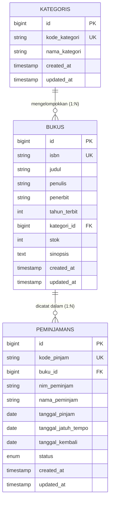
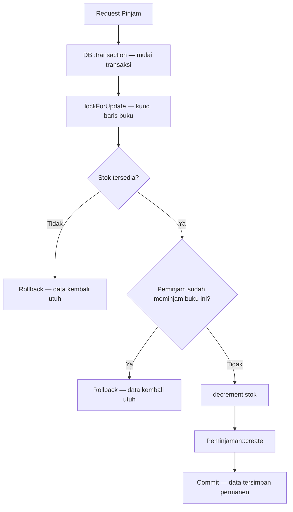

 # SIPUS-Del (Tahap 2) — Sistem Informasi Perpustakaan Kampus Del
 > Implementasi Konektivitas Basis Data Persisten (MySQL 8.0 & PDO), Transaksi Sirkulasi ACID & Concurrency Locking (`lockForUpdate`), Fluent Query Builder (`DB::table`), Manajemen Sesi Server-Side, serta Autentikasi Pustakawan pada Laravel 11.x.

Proyek ini dibangun untuk memenuhi penugasan mandiri **Praktikum Minggu 06** Mata Kuliah **Pemrograman & Pengujian Web (1253101)**.

---

## 👤 Identitas Pengembang

- **Nama Lengkap**: Choqy Pananda Sirait
- **NIM**: 12S24012
- **Program Studi**: Sistem Informasi
- **Kelas**: 13SI1
- **Dosen Pengampu**: Chandro Pardede, S.Kom., M.Sc.
- **Tahun Akademik**: Semester Ganjil 2026/2027
- **Institusi**: Institut Teknologi Del
- **Cabang Git**: `week6-db-session`

---
## Tampilan Desktop

#### Login Admin Perpustakaan 


#### Katalog Buku ( Admin Perpustakaan )


#### Kategori ( Admin Perpustakaan )


#### Siklus Peminjaman ( Admin Perpustakaan )


#### Tampilan Mode Tamu/Mahasiswa


--- 

## Tampilan Mobile 
#### Tamu/Mahasiswa


#### Login Admin Perpustakaan dan Fiturnya


## 🔐 Kredensial Akun Pengujian Sistem

Sesuai spesifikasi modul penugasan mandiri, sistem telah dilengkapi akun pustakawan bawaan (*Database Seeder*) untuk verifikasi autentikasi dan otorisasi:

- **Peran**: Pustakawan (Administrator Sirkulasi)
- **Alamat Surel**: `pustakawan@del.ac.id`
- **Kata Sandi**: `password123`

---

## 📊 Matriks Pemenuhan Rubrik Penilaian Praktikum Minggu 06

| Kriteria Evaluasi | Bobot | Implementasi Teknis pada Proyek SIPUS-Del | Status |
| :--- | :---: | :--- | :---: |
| **Konektivitas DB & Migrasi `peminjamans`** | 20% | Transisi tuntas ke mesin penyimpanan MySQL 8.0 InnoDB. Skema tabel `peminjamans` terkonfigurasi presisi dengan Foreign Key berstatus `cascadeOnDelete` menuju `bukus`. Relasi *One-to-Many* balik (`hasMany` ↔ `belongsTo`) didefinisikan pada Model Eloquent. | Sempurna |
| **Transaksi ACID & Concurrency Locking** | 25% | Logika sirkulasi pinjam dan kembali dibungkus utuh dalam `DB::transaction()`. Penguncian baris konkurensi diimplementasikan via `lockForUpdate()` (`SELECT ... FOR UPDATE`), mutasi stok atomik (`decrement`/`increment`), pencegahan pinjam ganda per NIM, pembatalan instan (*rollback*) saat stok = 0, serta penangkapan `QueryException` ke `Log::error()`. | Sempurna |
| **Query Builder, `withCount`, & Filter** | 15% | Empat kartu analitik perpustakaan dihitung via Fluent Query Builder `DB::table()` (tanpa *Object Hydration*). Katalog buku dilengkapi `withCount('peminjamans')` untuk menghindari masalah $N+1$, filter kriteria dinamis `when()`, dan penomoran halaman dengan persistensi URL `withQueryString()`. | Sempurna |
| **Manajemen Sesi, Cookie, & Auth** | 25% | Mekanisme Login/Logout Pustakawan via `Auth::attempt()`. Regenerasi ID sesi via `$request->session()->regenerate()` (anti-*Session Fixation*) dan sanitasi token CSRF via `invalidate()`. Seluruh rute mutasi data dikunci dengan `middleware('auth')`. Sesi server menyimpan histori peminjam, serta menanam HTTP Cookie terenkripsi berbendera `HttpOnly` dan `SameSite=Lax` via `Cookie::queue()`. | Sempurna |
| **Seeder, Bukti Uji ACID, & Dokumentasi** | 15% | Database Seeder memuat akun uji pustakawan, buku kasus batas (*edge-case*) dengan stok = 0 dan stok = 1, serta sampel transaksi aktif. README ini dilengkapi diagram Mermaid ERD 3 tabel, skenario demonstrasi uji batas, dan panduan audit Browser DevTools. | Sempurna |

---

## 📐 Diagram Relasi Basis Data (ERD)



## 🗄️ Skema Basis Data Relasional (MySQL 8.0 InnoDB)

1. **Tabel `kategoris`**:
   - `id` (Primary Key, unsignedBigInteger)
   - `kode_kategori` (VARCHAR 20, Unique)
   - `nama_kategori` (VARCHAR 100)
   - `created_at`, `updated_at` (Timestamps)
2. **Tabel `bukus`**:
   - `id` (Primary Key, unsignedBigInteger)
   - `isbn` (VARCHAR 30, Unique)
   - `judul` (VARCHAR 255)
   - `penulis` (VARCHAR 150)
   - `penerbit` (VARCHAR 150)
   - `tahun_terbit` (INTEGER)
   - `kategori_id` (Foreign Key mengarah ke `kategoris.id`, on delete cascade)
   - `stok` (INTEGER, non-negatif)
   - `sinopsis` (TEXT, nullable)
   - `created_at`, `updated_at` (Timestamps)
3. **Tabel `peminjamans`**:
   - `id` (Primary Key, unsignedBigInteger)
   - `kode_pinjam` (VARCHAR 30, Unique)
   - `buku_id` (Foreign Key mengarah ke `bukus.id`, on delete cascade)
   - `nim_peminjam` (VARCHAR 15)
   - `nama_peminjam` (VARCHAR 150)
   - `tanggal_pinjam` (DATE)
   - `tanggal_jatuh_tempo` (DATE)
   - `tanggal_kembali` (DATE, nullable)
   - `status` (ENUM: `'dipinjam'`, `'dikembalikan'`)
   - `created_at`, `updated_at` (Timestamps)

## ⚡ Transaksi Basis Data ACID & Concurrency Locking

Operasi peminjaman dan pengembalian buku melibatkan modifikasi multi-tabel simultan (tabel `bukus` dan `peminjamans`). Seluruh proses dikawal prinsip **ACID** (*Atomicity, Consistency, Isolation, Durability*):



### 1. Bahaya Race Condition & Solusi Pessimistic Locking

Jika stok buku bersisa 1, lalu dua pengguna menekan tombol pinjam pada milidetik yang sama tanpa mekanisme penguncian, keduanya akan membaca kondisi `stok = 1` secara paralel. Keduanya lolos validasi dan menjalankan pengurangan stok, menyebabkan sisa stok menjadi minus (-1).

- **Solusi**: Menggunakan `Buku::where('id', $id)->lockForUpdate()->firstOrFail()`. Kueri kedua dipaksa menunggu (*blocking lock*) di level MySQL InnoDB hingga transaksi pertama selesai (`COMMIT` atau `ROLLBACK`). Begitu transaksi kedua membaca baris data, stok sudah bernilai 0 dan sistem otomatis menolak peminjaman.

### 2. Pemulihan Stok pada Pengembalian Buku

Pada proses pengembalian, baris peminjaman dan baris buku dikunci secara bergantian dalam satu blok `DB::transaction()`. Status peminjaman diubah menjadi `'dikembalikan'`, waktu pengembalian dicatat, dan stok buku dipulihkan secara atomik melalui `$buku->increment('stok')`.

## 🚀 Fluent Query Builder & Agregasi Bebas Masalah N+1

### 1. Analitik Dasbor via `DB::table()` (Query Builder)

Metrik operasional perpustakaan dihitung tanpa membebani kapasitas RAM server akibat proses pemuatan objek Model Eloquent:

```php
$stats = [
	'total_judul'    => DB::table('bukus')->count(),
	'total_stok'     => (int) DB::table('bukus')->sum('stok'),
	'total_dipinjam' => DB::table('peminjamans')->where('status', 'dipinjam')->count(),
	'total_kembali'  => DB::table('peminjamans')->where('status', 'dikembalikan')->count(),
];
```

### 2. Agregasi Relasi via `withCount('peminjamans')`

Menghindari perulangan kueri individual per buku dengan menyuntikkan agregasi langsung ke dalam *single statement*:

```php
$bukus = Buku::with('kategori')
	->withCount('peminjamans')
	->when($request->filled('kategori_id'), fn ($q) => $q->where('kategori_id', $request->kategori_id))
	->when($request->filled('search'), function ($query) use ($request) {
		$search = $request->search;
		$query->where(fn ($q) => $q->where('judul', 'like', "%{$search}%")
			->orWhere('penulis', 'like', "%{$search}%")
			->orWhere('isbn', 'like', "%{$search}%"));
	})
	->latest()
	->paginate(10)
	->withQueryString();
```

## 🛡️ Keamanan Sesi Server-Side & Kebijakan Autentikasi

### 1. Mitigasi Session Fixation

Pada metode `AuthController::login()`, segera setelah kredensial divalidasi oleh `Auth::attempt()`, sistem mengeksekusi:

```php
$request->session()->regenerate();
```

Perintah ini menerbitkan ulang Session ID baru dan memusnahkan ID lama, menggagalkan upaya peretas yang mencoba mengeksploitasi sesi peramban yang telah dipersiapkan sebelumnya.

### 2. Atribut Keamanan Cookie (`HttpOnly` & `SameSite=Lax`)

Alamat surel login pustakawan disimpan ke peramban menggunakan:

```php
Cookie::queue('del_last_librarian_email', $request->email, 10080);
```

Peramban secara otomatis mengunci cookie ini dengan atribut:

- **`HttpOnly`**: Mencegah skrip JavaScript membaca data cookie dari objek `document.cookie`.
- **`SameSite=Lax`**: Membatasi pengiriman cookie lintas domain untuk menangkal serangan pemalsuan permintaan antar-situs (*CSRF*).

### 3. Matriks Pemisahan Hak Akses

- **Mode Tamu / Mahasiswa (`@guest`)**: Hanya memiliki izin membaca (*read-only*), dapat melihat kartu analitik, menelusuri katalog buku, memfilter kategori, dan mengakses halaman rincian. Seluruh tombol penambahan, pengubahan, penghapusan, dan peminjaman disembunyikan.
- **Pustakawan Terautentikasi (`@auth`)**: Memiliki izin penuh, membuka modul sirkulasi peminjaman, serta memproses pengembalian buku. Seluruh rute mutasi data dikunci di balik `Route::middleware('auth')`.

### 4. Matriks Rute Aplikasi

| Method | URL Endpoint | Controller Action | Proteksi Akses | Deskripsi Fungsional |
| :--- | :--- | :--- | :--- | :--- |
| GET | `/` | Redirect | Publik | Mengalihkan pengunjung langsung ke katalog buku (`buku.index`) |
| GET | `/buku` | `BukuController@index` | Publik | Katalog buku dengan Query Builder stats, Eager Loading, dan filter `when()` |
| GET | `/buku/{buku}` | `BukuController@show` | Publik | Rincian buku dan riwayat peminjaman terakhir |
| GET | `/kategori` | `KategoriController@index` | Publik | Daftar klasifikasi kategori beserta agregasi `withCount('bukus')` |
| GET | `/kategori/{kategori}` | `KategoriController@show` | Publik | Daftar buku yang terdaftar di bawah kategori bersangkutan |
| GET | `/login` | `AuthController@showLoginForm` | Tamu (`guest`) | Formulir masuk pustakawan dengan pembacaan cookie email tersimpan |
| POST | `/login` | `AuthController@login` | Tamu (`guest`) | Verifikasi `Auth::attempt()`, `session()->regenerate()`, dan set Cookie |
| POST | `/logout` | `AuthController@logout` | Pustakawan (`auth`) | Invalidasi sesi server, regenerasi token CSRF, dan keluar sistem |
| GET | `/buku/create` | `BukuController@create` | Pustakawan (`auth`) | Formulir pendaftaran judul koleksi buku baru |
| POST | `/buku` | `BukuController@store` | Pustakawan (`auth`) | Menyimpan data buku baru dengan validasi server-side |
| GET | `/buku/{buku}/edit` | `BukuController@edit` | Pustakawan (`auth`) | Formulir pembaruan data buku |
| PUT | `/buku/{buku}` | `BukuController@update` | Pustakawan (`auth`) | Memperbarui data buku dengan validasi unik ISBN |
| DELETE | `/buku/{buku}` | `BukuController@destroy` | Pustakawan (`auth`) | Menghapus buku beserta peminjaman terkait (cascade) |
| GET | `/kategori/create` | `KategoriController@create` | Pustakawan (`auth`) | Formulir penambahan kategori baru |
| POST | `/kategori` | `KategoriController@store` | Pustakawan (`auth`) | Menyimpan master kategori baru |
| GET | `/kategori/{kategori}/edit` | `KategoriController@edit` | Pustakawan (`auth`) | Formulir pembaruan kategori |
| PUT | `/kategori/{kategori}` | `KategoriController@update` | Pustakawan (`auth`) | Memperbarui data kategori |
| DELETE | `/kategori/{kategori}` | `KategoriController@destroy` | Pustakawan (`auth`) | Menghapus kategori beserta buku di dalamnya (cascade) |
| GET | `/peminjaman` | `PeminjamanController@index` | Pustakawan (`auth`) | Riwayat sirkulasi peminjaman dengan filter status dan pencarian |
| GET | `/peminjaman/create` | `PeminjamanController@create` | Pustakawan (`auth`) | Formulir pencatatan peminjaman buku baru |
| POST | `/peminjaman` | `PeminjamanController@store` | Pustakawan (`auth`) | Transaksi peminjaman atomik (`DB::transaction` + `lockForUpdate`) |
| POST | `/peminjaman/{id}/kembalikan` | `PeminjamanController@kembalikan` | Pustakawan (`auth`) | Transaksi pengembalian buku dan pemulihan stok fisik |

## 🧪 Panduan Demonstrasi Video Pengujian Sistem

Skenario terstruktur berikut disiapkan untuk mempermudah peragaan pada video presentasi:

### 1. Pengujian Rollback Transaksi ACID (Kasus Batas Stok = 0)

1. Akses halaman login (`/login`), masukkan kredensial: `pustakawan@del.ac.id` / `password123`.
2. Buka menu **Sirkulasi Peminjaman** → klik **Catat Peminjaman Baru**.
3. Pilih buku: *"Arsitektur Komputasi Cloud Skala Enterprise"* (buku hasil seeder yang memiliki sisa stok 0).
4. Masukkan identitas peminjam (NIM: `12S24099`, Nama: `Budi Santoso`), lalu kirim formulir peminjaman.
5. **Evaluasi Sistem**: Aplikasi menampilkan notifikasi peringatan merah *"Stok buku telah habis. Peminjaman dibatalkan."*. Transaksi dibatalkan secara atomik (*rollback*), tabel `peminjamans` tidak bertambah, dan stok buku tetap 0.

### 2. Pengujian Transaksi Berhasil & Pemulihan Stok (Stok = 1)

1. Pada form peminjaman, pilih buku: *"Struktur Data dan Algoritma Lanjut dengan Go"* (buku hasil seeder bersisa stok 1).
2. Masukkan identitas peminjam, lalu kirim formulir peminjaman.
3. **Evaluasi Sistem**: Transaksi berhasil diproses. Buka katalog buku; stok buku tersebut berkurang menjadi 0 (label berubah menjadi "Habis") dan frekuensi peminjaman bertambah 1x.
4. Buka menu **Sirkulasi Peminjaman**, cari transaksi tersebut, lalu klik tombol **Kembalikan**.
5. **Evaluasi Sistem**: Status transaksi berubah menjadi *"Dikembalikan"* dengan tanggal kembali terisi. Stok fisik buku di katalog otomatis pulih kembali menjadi 1.

### 3. Audit Cookie & Manajemen Sesi pada Browser DevTools

1. Tekan tombol **F12** pada peramban untuk membuka jendela Developer Tools.
2. Navigasikan ke tab **Application** → bentangkan menu **Storage** → pilih **Cookies** → `http://127.0.0.1:8000`.
3. Tunjukkan dua bukti keamanan:
   - **`laravel_session`**: Terverifikasi memiliki tanda centang aktif pada kolom **HttpOnly** serta nilai **SameSite = Lax**.
   - **`del_last_librarian_email`**: Memuat email pustakawan yang tersimpan aman untuk memudahkan proses login berikutnya.

## 🚀 Panduan Instalasi Lokal

### 1. Klon Repositori & Berpindah ke Branch Minggu 06

```bash
git clone https://github.com/ChoqySirait/ppw-2026-week5-12S24012.git
cd ppw-2026-week5-12S24012
git checkout week6-db-session
```

### 2. Pasang Dependensi Framework

```bash
composer install --no-dev --prefer-dist --optimize-autoloader
```

### 3. Konfigurasi Lingkungan Basis Data (`.env`)

Salin templat konfigurasi dan generate app key:

```bash
cp .env.example .env
php artisan key:generate
```

Pastikan parameter basis data MySQL di berkas `.env` telah terkonfigurasi ke mesin Laragon/MySQL lokal:

```dotenv
DB_CONNECTION=mysql
DB_HOST=127.0.0.1
DB_PORT=3306
DB_DATABASE=sipus_del
DB_USERNAME=root
DB_PASSWORD=
```

### 4. Eksekusi Migrasi & Data Seeder

```bash
php artisan migrate:fresh --seed
```

### 5. Jalankan Server Lokal

```bash
php artisan serve
```
