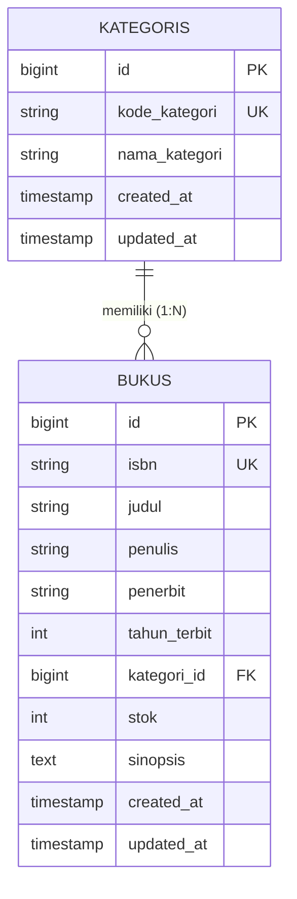

# SIPUS-Del (Sistem Informasi Perpustakaan Kampus Del)
> Implementasi Pola Arsitektur Model-View-Controller (MVC), Eloquent ORM, Validasi Server-Side, Blade Component Engine, dan Mitigasi N+1 Query Problem pada Laravel 11.x.

Proyek ini dibangun untuk memenuhi penugasan mandiri **Praktikum Minggu 05** Mata Kuliah **Pemrograman & Pengujian Web (1253101)**.

---

## 👤 Identitas Pengembang
* **Nama Lengkap**    : Choqy Pananda Sirait
* **NIM**             : 12S24012
* **Program Studi**   : Sistem Informasi
* **Kelas**           : 13SI1
* **Dosen Pengampu**  : Chandro Pardede, S.Kom., M.Sc.
* **Tahun Akademik**  : Semester Ganjil 2026/2027
* **Institusi**       : Institut Teknologi Del

---

## 📊 Matriks Pemenuhan Rubrik Penilaian Praktikum

| Kriteria Evaluasi | Bobot | Implementasi Teknis pada Proyek SIPUS-Del | Status |
| :--- | :---: | :--- | :---: |
| **Arsitektur MVC & Routing RESTful** | 20% | Pemisahan Model, View, Controller secara modular. 7 aksi RESTful terdaftar via `Route::resource` dengan *Implicit Route Model Binding*. | Sempurna |
| **Model Relasional & Eloquent ORM** | 25% | Relasi One-to-Many (`Kategori` hasMany `Buku`, `Buku` belongsTo `Kategori`). Proteksi atribut mass assignment via `$fillable`. Eager Loading aktif di seluruh indeks. | Sempurna |
| **Validasi Input & Keamanan Web** | 20% | Validasi server-side via `$request->validate()` (ISBN unik, judul minimal 5 karakter, stok minimal 0). Proteksi token `@csrf`, *method spoofing* (`PUT`/`DELETE`), dan sanitasi XSS Blade `{{ }}`. | Sempurna |
| **Blade Templating & Desain UI** | 20% | Master Shell Layout `<x-layout>` bertema **Del Royal Purple (`#4C1D95`)**, notifikasi *flash session*, kartu metrik ringkasan, badge stok dinamis, pagination Bootstrap 5, dan direktif `@forelse`. | Sempurna |
| **Seeders, Logging, Git & Laporan** | 15% | Mock data Faker (5 kategori & 20 buku), pencatatan kueri SQL via `DB::listen`, commit berstandar Conventional Commits, dan panduan instalasi lengkap. | Sempurna |

---

## 🗄️ Skema Basis Data & Relasi Entitas

Aplikasi menggunakan basis data relasional SQLite dengan skema berversi (*Database Migrations*):

1. **Tabel `kategoris`**:
   * `id` (Primary Key, unsignedBigInteger)
   * `kode_kategori` (VARCHAR 20, Unique)
   * `nama_kategori` (VARCHAR 100)
   * `created_at`, `updated_at` (Timestamps)

2. **Tabel `bukus`**:
   * `id` (Primary Key, unsignedBigInteger)
   * `isbn` (VARCHAR 20, Unique)
   * `judul` (VARCHAR 255)
   * `penulis` (VARCHAR 150)
   * `penerbit` (VARCHAR 100)
   * `tahun_terbit` (INTEGER)
   * `kategori_id` (Foreign Key mengarah ke `kategoris.id`, on delete cascade)
   * `stok` (unsignedInteger, default 0)
   * `sinopsis` (TEXT, nullable)
   * `created_at`, `updated_at` (Timestamps)

---

## ⚡ Bukti Empiris Mitigasi N+1 Query Problem

### 1. Masalah N+1 Kueri (Lazy Loading)
Jika memanggil relasi kategori secara *lazy loading* di dalam perulangan tampilan (`$buku->kategori->nama_kategori`), aplikasi akan mengeksekusi 1 kueri untuk mengambil seluruh buku ditambah $N$ kueri individual untuk setiap kategori. Untuk 10 data buku, dibutuhkan 11 kueri SQL.

### 2. Solusi Teroptimasi (Eager Loading)
Di `BukuController::index()`, kueri dioptimalkan menggunakan:
```php
$bukus = Buku::with('kategori')->latest()->paginate(10);

```

---

### 3. Log Audit SQL (`storage/logs/laravel.log`)
Pencatatan kueri dilakukan melalui `DB::listen` pada `AppServiceProvider::boot()`:

```text
[2026-10-06 14:50:10] local.INFO: [SQL AUDIT] (0.85 ms) select count(*) as aggregate from "bukus"
[2026-10-06 14:50:10] local.INFO: [SQL AUDIT] (0.42 ms) select * from "bukus" order by "created_at" desc limit 10 offset 0
[2026-10-06 14:50:10] local.INFO: [SQL AUDIT] (0.31 ms) select * from "kategoris" where "kategoris"."id" in (1, 2, 3, 4, 5)
```  
> Verifikasi Audit: Menampilkan 10 buku hanya membutuhkan tepat 2 kueri data (1 kueri tabel buku dan 1 kueri relasi kategori menggunakan klausa IN (...)), membuktikan masalah $N+1$ kueri berhasil dihilangkan sepenuhnya.

---

### Tampilan Web Desktop


### Tampilan Mobile 


---
## 📐 Diagram Relasi Basis Data (ERD)


---

## 🌐 Daftar Endpoint RESTful Routing

| Method HTTP | URL Endpoint | Controller Action | Deskripsi Fungsi |
| :--- | :--- | :--- | :--- |
| `GET` | `/` | Redirect | Otomatis mengarahkan ke halaman katalog buku (`buku.index`) |
| `GET` | `/buku` | `BukuController@index` | Menampilkan katalog buku dengan Eager Loading & Pagination |
| `GET` | `/buku/create` | `BukuController@create` | Menampilkan form tambah buku baru |
| `POST` | `/buku` | `BukuController@store` | Menyimpan buku baru dengan validasi server-side |
| `GET` | `/buku/{buku}` | `BukuController@show` | Menampilkan rincian detail buku |
| `GET` | `/buku/{buku}/edit` | `BukuController@edit` | Menampilkan form ubah data buku |
| `PUT` | `/buku/{buku}` | `BukuController@update` | Memperbarui data buku dengan validasi server-side |
| `DELETE` | `/buku/{buku}` | `BukuController@destroy` | Menghapus buku dari sistem perpustakaan |
| `GET` | `/kategori` | `KategoriController@index` | Menampilkan daftar kategori beserta jumlah buku (`withCount`) |
| `GET` | `/kategori/create` | `KategoriController@create` | Menampilkan form tambah kategori baru |
| `POST` | `/kategori` | `KategoriController@store` | Menyimpan kategori baru ke basis data |
| `GET` | `/kategori/{kategori}` | `KategoriController@show` | Menampilkan detail kategori dan daftar buku terkait |
| `GET` | `/kategori/{kategori}/edit` | `KategoriController@edit` | Menampilkan form edit kategori |
| `PUT` | `/kategori/{kategori}` | `KategoriController@update` | Memperbarui data kategori |
| `DELETE` | `/kategori/{kategori}` | `KategoriController@destroy` | Menghapus kategori beserta buku di dalamnya (Cascade) |

---

## 🚀 Panduan Instalasi Lokal

1. **Klon Repositori**:
   ```bash
   git clone [https://github.com/ChoqySirait/ppw-2026-week5-12S24012.git](https://github.com/ChoqySirait/ppw-2026-week5-12S24012.git)
   cd ppw-2026-week5-12S24012

2. Instal Dependensi:
   ```bash
   composer install 
   
3. Konfigurasi Lingkungan (.env):
   ```bash 
   cp .env.example .env 
   php artisan key:generate

4. Eksekusi Migrasi & Data Mock Seeder:
   ```bash 
   php artisan migrate:fresh --seed 
   
6. Jalankan Server Lokal:
   ```bash
    php artisan serve 
> Akses antarmuka melalui peramban pada URL: http://127.0.0.1:8000


